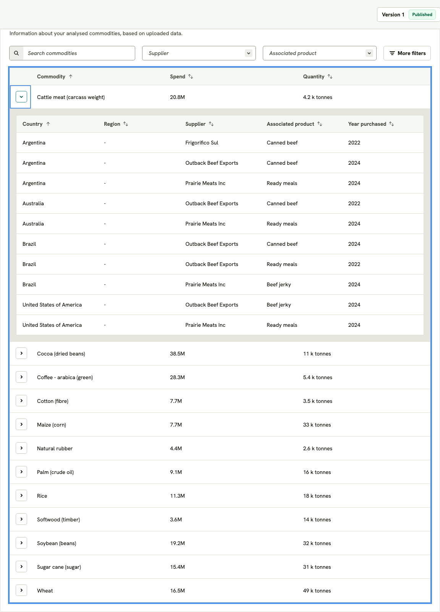
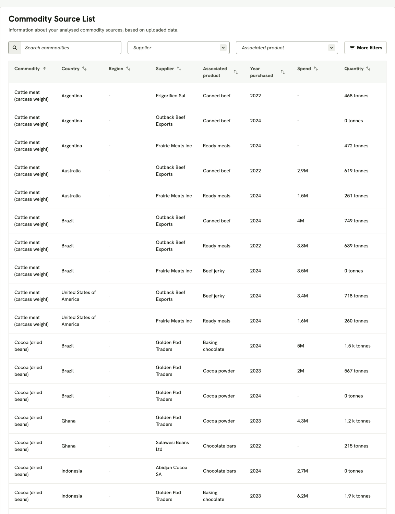

# The task

Read [README.md](README.md) first: it tells you how to install, run and test
this repository. The **Commodities Overview** page you see when the app is
running is the starting point.

## What to build

The Commodities Overview page currently has a single tab, **Map View**. Add
two more tabs next to it, in this order:

1. **Commodity List**
2. **Commodity Source List**

Both tabs show the same underlying data as the rest of the page — the
organisation's *commodity sources* for the version (change set) currently
selected in the top-right panel — in two different shapes. Switching the
version in that panel must switch what the tabs show, exactly as it does for
the map and the stat cards.

A *commodity source* is one purchase line: a commodity (e.g. "Cocoa (dried
beans)"), bought from a supplier, sourced from a country (and optionally a
region within it), in a given year, used for an associated product, with a
spend (in the organisation's currency) and a quantity (in kilograms). Spend
and quantity may be missing on some sources.

### Tab 1 — Commodity List

A card titled **Commodity List** with the tagline *"Information about your
analysed commodities, based on uploaded data."*, containing one table with
one row per **commodity**:

| Column | Content |
|---|---|
| Commodity | the commodity name |
| Spend | total spend across the commodity's sources |
| Quantity | total quantity across the commodity's sources |

- Each commodity row can be **expanded** to reveal its sources in a nested
  table with the columns **Country, Region, Supplier, Associated product,
  Year purchased**, one row per source.
- Both the commodity table and each nested table are **sortable by every
  column** (click the header to toggle ascending/descending). Default order:
  commodities A→Z; nested sources by country A→Z.
- Nested tables show at most **100 rows per page**, with previous/next
  controls and a "page *n* of *m*" label when there is more than one page.

### Tab 2 — Commodity Source List

A card titled **Commodity Source List** with the tagline *"Information about
your analysed commodity sources, based on uploaded data."*, containing one
flat table with one row per **commodity source**:

| Column | Content |
|---|---|
| Commodity | the commodity name |
| Country | sourcing country |
| Region | sourcing region within the country |
| Supplier | supplier name |
| Associated product | the product this purchase feeds into |
| Year purchased | year |
| Spend | spend of this source |
| Quantity | quantity of this source |

- **Sortable by every column**; default order: commodity A→Z.
- At most **100 rows per page**, with previous/next controls and a
  "page *n* of *m*" label when there is more than one page.

### Filters (both tabs)

Above each table, the same filter bar:

- a **search box** to pick one or more commodities (type-ahead, multi-select);
- a **Supplier** multi-select and an **Associated product** multi-select;
- a **More filters** button opening a panel with **Country**, **Region** and
  **Year purchased** multi-selects, showing a badge with how many of those
  three are active;
- a **Clear all** link, shown only when at least one filter is active.

Filter options are the distinct values present in the selected version's
data. Filters combine (a source must match every active filter) and apply to
the whole table, including the totals in the Commodity List and its nested
rows.

### Presentation

- Match the look and feel of the existing page (the same card, table,
  heading, pagination and filter styling as the rest of the dashboard).
- Missing text values (country, region, supplier, product, year) and a
  missing spend are shown as "-".
- Spend is shown in the compact style used elsewhere on the page (e.g.
  `183.6M`); quantity is shown as a weight in the style used on the stat
  cards (e.g. `216 k tonnes`), with a missing quantity shown as `0 tonnes`.
- Loading, error and "no data" states should behave like the other parts of
  the page.

### Reference screenshots

These show the two tabs as they exist in the full product, on this same
seed data. Match them in content and behaviour; pixel-perfection is not the
point.

### Scale

An organisation can have **up to 10,000 commodity sources** in a version.
Both tabs must stay responsive at that size — opening a tab, sorting,
filtering and paging should feel immediate. How you achieve that is part of
the task.

## How to work

Use an AI coding assistant (Claude Code, Cursor, Copilot, Codex, Aider — your
choice) as your **primary** development mechanism: explore the repository,
design, implement and test with it. We are as interested in *how* you drive
the tool as in the result. There is no hidden spec beyond this file and the
running application; the codebase is yours to discover.

The existing code, tests and tooling (`pnpm run check`, `pnpm test`,
`poetry run pytest`, …) are the quality bar: your change should leave them
green and should come with tests of its own where the codebase would
normally have them.

## What to submit

Either a **public GitHub repository** (a fork or a fresh repo containing this
code plus your changes) or a **zip** of the repository, containing:

1. **The code** — your implementation of the two tabs, with the rest of the
   repository still building, running and passing its checks.
2. **The prompts** — the prompts/conversations you used to get there, as
   faithfully as your tool allows (exported sessions, copied transcripts, or
   a `PROMPTS.md`). Include the ones that didn't work; they are often more
   interesting than the ones that did.
3. **Your notes** — a short write-up (a `NOTES.md` is fine) covering: how you
   approached the problem, what you asked the AI to do versus what you did
   yourself, decisions and trade-offs (especially around the 10,000-source
   requirement), what you would do next with more time, and anything you
   found surprising in the codebase. Any other artefacts you produced
   (diagrams, plans, screenshots) are welcome.

Please do not spend more than a few hours on this. An honest, partial
solution with clear notes beats a polished one with no trace of how it was
made.
